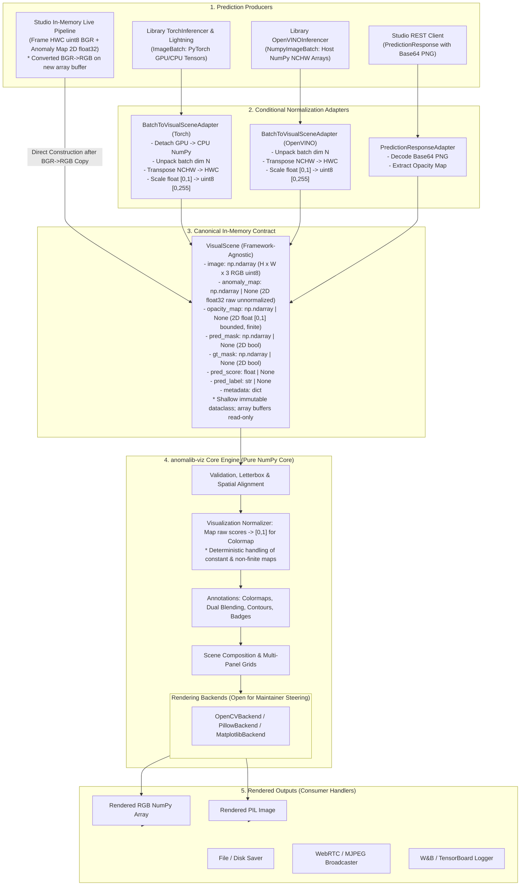

# RFC: Modular Visualization Architecture for Anomalib and Studio

This Request for Comments (RFC) outlines the architectural proposal to unify visualization across the Anomalib core library and the Studio application into a single modular, framework-agnostic package (`anomalib-viz` or subpackage `anomalib.viz`), as requested in GitHub Issue [#3872](https://github.com/open-edge-platform/anomalib/issues/3872).

---

## 1. Problem and Motivation

### 1.1 Context and Problem Statement
Visualization in Anomalib is essential for inspecting model predictions, diagnosing anomaly heatmaps, and streaming real-time camera inspection in the Studio application. However, visualization logic is currently split across three independent Python implementations and a TypeScript frontend.

This division causes several problems:
1. **Divergent Visual Outputs:** The core library visualizer applies uniform alpha blending across the image canvas. The Studio application modulates transparency per pixel based on anomaly scores. Consequently, the exact same model weights and test image produce visibly different heatmaps between the library and Studio.
2. **Heavy Framework Coupling:** The modern library visualizer imports `torch`, `torchvision`, and `lightning`. Users running lightweight inference engines (such as OpenVINO on edge gateways or microservices) must install gigabytes of deep learning training dependencies merely to render an overlay.
3. **Redundant Work in Live Streaming:** In Studio's camera inspection pipeline, frames undergo repeated compression and decompression cycles between worker methods (JPEG camera decoding, NumPy inference, PNG heatmap encoding, Base64 conversion, Base64 decoding, and alpha compositing).
4. **Code Duplication and Maintenance Overhead:** Core visualization tasks (colormap generation, alpha blending, status badge drawing, and image resizing) are independently implemented across multiple subsystems using different graphic toolkits (OpenCV, Pillow, and Matplotlib).

### 1.2 Governance and Pre-Implementation Review Gate
In strict accordance with the instructions on GitHub Issue #3872:
- **Pre-Implementation Architectural Proposal Only:** This pull request contains documentation, technical specifications, and architectural decision records. No production source code, unit tests, dependencies, or configuration files have been modified.
- **Implementation Gate:** No production code changes will be implemented until project maintainers review and approve this RFC and its accompanying ADRs.
- **Status `PROPOSED`:** All architectural decisions are submitted as proposals (`PROPOSED`) across ten individual records in the [`adr/`](adr/) directory (indexed in [`adr/README.md`](adr/README.md)). No decision is marked accepted prior to maintainer consensus.
- **Preserved `OPEN` Questions:** Decisions with multiple valid engineering paths are explicitly cataloged as `OPEN` for maintainer steering.
- **Empirical Grounding:** All claims regarding dependencies, code duplication, and defect behaviors are verified against the repository checkout (`0e21c0a2d2a535de0531de9c30b92250cc20df64`). No performance improvements or speedups are claimed without benchmarks.

---

## 2. Existing Implementation Analysis

I audited the existing repository checkout (`open-edge-platform/anomalib` at commit `0e21c0a`) to map the visualization subsystems and integration points:

### 2.1 Visualization Subsystems
1. **Modern Library Visualizer (`src/anomalib/visualization/image/`):**
   - [`visualizer.py`](https://github.com/open-edge-platform/anomalib/blob/0e21c0a2d2a535de0531de9c30b92250cc20df64/src/anomalib/visualization/image/visualizer.py): Defines `ImageVisualizer` and `Visualizer`, subclassing PyTorch Lightning `Callback`.
   - [`item_visualizer.py`](https://github.com/open-edge-platform/anomalib/blob/0e21c0a2d2a535de0531de9c30b92250cc20df64/src/anomalib/visualization/image/item_visualizer.py): Orchestrates individual image visualization, grid layouts, and filename formatting.
   - [`functional.py`](https://github.com/open-edge-platform/anomalib/blob/0e21c0a2d2a535de0531de9c30b92250cc20df64/src/anomalib/visualization/image/functional.py): Implements rasterization primitives via Pillow, TorchVision transforms, and PyTorch tensor operations.
2. **Legacy Library Visualizer (`src/anomalib/utils/visualization/` & `post_processing.py`):**
   - [`base.py`](https://github.com/open-edge-platform/anomalib/blob/0e21c0a2d2a535de0531de9c30b92250cc20df64/src/anomalib/utils/visualization/base.py) & [`image.py`](https://github.com/open-edge-platform/anomalib/blob/0e21c0a2d2a535de0531de9c30b92250cc20df64/src/anomalib/utils/visualization/image.py): Defines `Visualizer`, `ImageVisualizer`, `ImageResult`, and `_ImageGrid`, rendering multi-panel figures via Matplotlib `plt.subplots`.
   - [`post_processing.py`](https://github.com/open-edge-platform/anomalib/blob/0e21c0a2d2a535de0531de9c30b92250cc20df64/src/anomalib/utils/post_processing.py): Implements OpenCV Jet colormapping (`cv2.applyColorMap`), weighted alpha blending (`cv2.addWeighted`), and status badge rendering.
3. **Studio Application Backend (`application/backend/src/`):**
   - [`services/model_service.py`](https://github.com/open-edge-platform/anomalib/blob/0e21c0a2d2a535de0531de9c30b92250cc20df64/application/backend/src/services/model_service.py): Runs inference pipelines, derives opacity maps, generates Jet colormaps via OpenCV, and encodes heatmaps to Base64 PNG.
   - [`utils/visualization.py`](https://github.com/open-edge-platform/anomalib/blob/0e21c0a2d2a535de0531de9c30b92250cc20df64/application/backend/src/utils/visualization.py): Implements custom per-pixel alpha blending using NumPy array arithmetic and OpenCV text compositing.
   - [`workers/inference.py`](https://github.com/open-edge-platform/anomalib/blob/0e21c0a2d2a535de0531de9c30b92250cc20df64/application/backend/src/workers/inference.py): Manages multi-threaded video streaming and frame inference.
4. **Studio Application Frontend (`application/ui/`):**
   - [`stream.component.tsx`](https://github.com/open-edge-platform/anomalib/blob/0e21c0a2d2a535de0531de9c30b92250cc20df64/application/ui/src/features/inspect/stream-container/stream/stream.component.tsx): Renders video streams via an HTML `` element consuming an MJPEG backend URL.

### 2.2 Model and Inferencer Touchpoints
- [`src/anomalib/models/components/base/anomalib_module.py:125, 458`](https://github.com/open-edge-platform/anomalib/blob/0e21c0a2d2a535de0531de9c30b92250cc20df64/src/anomalib/models/components/base/anomalib_module.py#L458): Initializes visualizers and defines `configure_visualizer() -> ImageVisualizer`.
- [`src/anomalib/callbacks/visualizer.py:47, 98-150`](https://github.com/open-edge-platform/anomalib/blob/0e21c0a2d2a535de0531de9c30b92250cc20df64/src/anomalib/callbacks/visualizer.py#L98-L150): `_VisualizationCallback` hooks into Lightning `on_test_batch_end`.
- [`src/anomalib/deploy/inferencers/torch_inferencer.py:249-274`](https://github.com/open-edge-platform/anomalib/blob/0e21c0a2d2a535de0531de9c30b92250cc20df64/src/anomalib/deploy/inferencers/torch_inferencer.py#L249-L274): Returns `ImageBatch` holding GPU/CPU PyTorch tensors.
- [`src/anomalib/deploy/inferencers/openvino_inferencer.py:196-220`](https://github.com/open-edge-platform/anomalib/blob/0e21c0a2d2a535de0531de9c30b92250cc20df64/src/anomalib/deploy/inferencers/openvino_inferencer.py#L196-L220): Returns `NumpyImageBatch` holding host NumPy arrays.

---

## 3. Findings and Actual Duplication

### 3.1 Comparison of Responsibilities and Algorithms
Inspection of the three Python implementations reveals where functionality is duplicated and where algorithms diverge:

| Task | Legacy Library (`utils/visualization/`) | Modern Library (`visualization/image/`) | Studio Backend (`application/backend/src/...`) | Analysis of Differences |
| :--- | :--- | :--- | :--- | :--- |
| **Colormap Mapping** | `post_processing.py:236-242`: scales to `[0, 255]`, calls `cv2.applyColorMap(..., cv2.COLORMAP_JET)`, converts `COLOR_BGR2RGB`. | `functional.py:187-278`: implements custom PyTorch tensor bilinear interpolation across 9 anchors (`F.interpolate`) to build a 256-color palette for Pillow. | `model_service.py:339-344`: calls `cv2.applyColorMap(..., cv2.COLORMAP_JET)`, converts to RGBA, injects alpha, and encodes to Base64 PNG. | **Repeated responsibility, divergent algorithms:** Legacy and Studio share the OpenCV Jet lookup routine. Modern re-implements Jet colormapping via PyTorch tensor interpolation, introducing an unnecessary PyTorch dependency. |
| **Alpha Blending** | `post_processing.py:302-305`: resizes image, calls `cv2.addWeighted(heatmap, alpha, image, 1-alpha, 0)` with uniform scalar $\alpha \in [0, 1]$. | `functional.py:280-305`: resizes overlay, converts to RGBA, calls Pillow `Image.blend(base, overlay, alpha)` with uniform scalar $\alpha \in [0, 1]$. | `visualization.py:63-67`: manual NumPy array arithmetic: `(overlay_rgb * alpha_map + base * (1 - alpha_map)).astype(np.uint8)` modulating by anomaly score. | **Divergent visual semantics:** Both library visualizers implement uniform global alpha blending. Studio implements score-weighted per-pixel blending. Identical predictions render visibly differently between tools. |
| **Status Badges** | `post_processing.py:120-195`: calculates dynamic font scale from image dimensions, draws filled box and text via `cv2.putText`. | `functional.py:89-180`: calculates dynamic font size, draws background box and text via Pillow `ImageDraw.textbbox`, `rectangle`, `text`. | `visualization.py:73-102`: measures text via `cv2.getTextSize`, composites translucent background with `cv2.addWeighted`, draws text with `cv2.putText`. | **Repeated task across graphic toolkits:** Text measurement, box padding, and status badges are independently implemented in OpenCV and Pillow. |
| **Spatial Alignment & Resizing** | `post_processing.py:304`: `cv2.resize(image, (width, height))` to match anomaly map; `image.py:240-270` uses Matplotlib subplot grids. | `item_visualizer.py:351`: `image.resize(field_size)` directly where `field_size=(256, 256)`, squashing non-square aspect ratios. | `visualization.py:60`: `cv2.resize(overlay, (w, h))` resizing heatmap overlay to native camera frame resolution. | **Inconsistent resizing:** Modern squashes non-square camera frames into 256x256 squares; Studio preserves native camera frame aspect ratios. |

### 3.2 AST Dependency and Coupling Analysis
Using static AST analysis across the repository:
- **54 import statements** touch visualization across **45 unique files**.
- **36 class constructors (`__init__`)** declare a `visualizer` parameter.
- **34 concrete Lightning model classes** accept `visualizer: Visualizer | bool = True` in `__init__` and pass it directly to `super().__init__(..., visualizer=visualizer)`. Zero models override `configure_visualizer()` or customize visualization logic.

### 3.3 Empirical Code Audit and Defect Verification
Through source inspection and runtime verification against the repository checkout, I analyzed four issues and behavioral limitations across the existing visualizers:

1. **Defect 1 — Confirmed Runtime Defect (`AttributeError` on `{0, 255}` uint8 binary masks):**
   In `ImageResult.__post_init__` (`src/anomalib/utils/visualization/image.py:128-135`), mask processing is gated behind `if self.pred_mask.max() <= 1.0:`. When a standard integer binary mask with values in `{0, 255}` is passed, this condition evaluates to false, leaving `self.segmentations` unassigned. Any subsequent call to `repr(res)` or `vis._visualize_full(res)` crashes with `AttributeError: 'ImageResult' object has no attribute 'segmentations'`. (Confirmed via runtime execution).
2. **Defect 2 — Confirmed Runtime Defect (`np.ptp` divide-by-zero on uniform anomaly maps):**
   In `src/anomalib/utils/post_processing.py:236-239`, normalization computes `(anomaly_map - anomaly_map.min()) / np.ptp(anomaly_map)`. When an anomaly map is constant across all pixels, `np.ptp(anomaly_map)` is `0.0`, triggering `RuntimeWarning: invalid value encountered in divide` and filling the array with `NaN`. (Confirmed via runtime execution).
3. **Finding 3 — Unsupported Capability / Enum Limitation (Detection task rejection):**
   In `src/anomalib/utils/visualization/image.py:339-340`, passing `task="detection"` (permitted by type hint `TaskType | str`) causes `_visualize_simple` to raise `ValueError: Unknown task type: detection`. Code inspection of `src/anomalib/__init__.py:65-72` confirms that Anomalib's `TaskType` enum defines only `CLASSIFICATION` and `SEGMENTATION`. This is not an active algorithmic bug in an implemented feature, but a domain limitation: object detection is unsupported in core Anomalib.
4. **Defect 4 — Confirmed Design Limitation (Aspect ratio distortion in `ItemVisualizer`):**
   In `src/anomalib/visualization/image/item_visualizer.py:351`, the visualizer resizes all images to `field_size=(256, 256)` directly via `image.resize(field_size)`. When passed a standard 16:9 industrial inspection frame (`1920x1080`), it forcibly squashes the image into a 1:1 square, distorting defect aspect ratios and spatial geometry. (Confirmed via runtime execution).

### 3.4 OpenVINO Inferencer PyTorch Coupling Audit
I traced the runtime import chain of `OpenVINOInferencer` using a `sys.meta_path` import hook:
1. `src/anomalib/deploy/inferencers/openvino_inferencer.py:57` executes top-level `import torch`.
2. `src/anomalib/deploy/inferencers/base_inferencer.py:24` imports `normalize_min_max` from `src/anomalib/utils/normalization/min_max.py`, where line 28 executes `import torch`.
3. `src/anomalib/data/dataclasses/__init__.py:80` unconditionally imports PyTorch batch classes when `openvino_inferencer.py:61` imports `NumpyImageBatch`.

In contrast, `base_inferencer.py:32` references `ImageResult` strictly under `if TYPE_CHECKING:`. Therefore, visualization is not the cause of PyTorch imports during OpenVINO inference. Extracting visualization decouples the rendering engine from PyTorch, but **does not make Anomalib's existing OpenVINO inference PyTorch-independent**. That requires a separate core refactoring outside the scope of issue #3872.

---

## 4. Requirements and Proposed Goals

From Issue #3872 and my audit findings, I derived ten architectural requirements:

- **R1 (Unified Architecture):** Replace the three fragmented implementations with a single modular engine shared by library models and Studio application services.
- **R2 (Framework Independence):** The core package establishes a framework-independent baseline with lower bound `numpy >= 1.26.0`, free of `torch`, `torchvision`, `lightning`, or `torchmetrics` imports. NumPy 1.26 supports the core Python 3.10–3.12 environments; Python 3.13 environments require a 3.13-compatible release (Studio resolves NumPy 2.3.5).
- **R3 (Canonical Data Contract):** Define a standard in-memory domain object (`VisualScene`) representing input images, raw continuous anomaly maps, optional opacity maps, masks, and metadata.
- **R4 (Preserve Raw Scores):** Do not mutate raw model scores in-place. Normalization to $[0.0, 1.0]$ must be treated as a display-only operation performed on an isolated array copy.
- **R5 (Support Both Blending Modes):** Natively support both uniform alpha blending (library semantic) and score-weighted per-pixel blending (Studio semantic) using an independent `opacity_map`.
- **R6 (Conditional Adapters):** Avoid redundant abstraction layers. Callers whose memory structures match `VisualScene` construct it directly. Adapters are reserved for batched tensors or serialized payloads.
- **R7 (Pluggable Rendering Engines):** Isolate rasterization primitives behind a backend protocol, allowing Pillow, OpenCV, or Matplotlib to be selected based on deployment constraints.
- **R8 (Preserve Aspect Ratios):** Provide letterbox resizing with neutral padding to preserve defect geometry on non-square camera frames.
- **R9 (Backward Compatibility):** Maintain existing public interfaces (`AnomalibModule.configure_visualizer()`, `_VisualizationCallback`, and constructor signatures across 34 models) via compatibility wrappers throughout a phased transition.
- **R10 (Scope Boundary):** Defer bounding box annotations to Phase 2, as object detection is not defined in core Anomalib task enums.

---

## 5. Proposed Package Architecture

I propose extracting visualization into a modular package tentatively named **`anomalib-viz`** (or subpackage `anomalib.viz`).

The architecture is organized around four decoupled layers:



---

## 6. Canonical Visualization Data Contract (`VisualScene`)

### 6.1 Dataclass Specification
The foundational domain object is `VisualScene`, representing visualization inputs using standard NumPy arrays:

```python
from dataclasses import dataclass, field
from typing import Any
import numpy as np

@dataclass(frozen=True)
class VisualScene:
    """Canonical data contract for visualization inputs.

    Immutability Note:
      Python's @dataclass(frozen=True) enforces shallow attribute immutability
      (preventing reassignment of attributes), but does not guarantee deep
      immutability of underlying NumPy memory buffers. Downstream rendering
      routines treat input array buffers as strictly read-only and never
      mutate them in-place.
    """
    # Original image: required H x W x 3 uint8 in RGB color space
    image: np.ndarray

    # Raw continuous anomaly map: 2D float32 array with model distance/score semantics
    # Preserves exact numerical values produced by the model (never mutated in-place)
    anomaly_map: np.ndarray | None = None

    # Optional pre-computed opacity map: 2D float array strictly bounded in [0.0, 1.0] and finite
    # If None, the renderer derives opacity from anomaly_map using the configured normalization policy
    opacity_map: np.ndarray | None = None

    # Optional prediction mask: 2D bool matching image spatial dimensions
    pred_mask: np.ndarray | None = None

    # Optional ground truth mask: 2D bool matching image spatial dimensions
    gt_mask: np.ndarray | None = None

    # Optional image-level anomaly score (scalar float, uncalibrated or calibrated)
    pred_score: float | None = None

    # Optional image-level prediction label (e.g. 'Normal', 'Anomalous')
    pred_label: str | None = None

    # Optional metadata dictionary (e.g. latency, camera_id)
    metadata: dict[str, Any] = field(default_factory=dict)

    def __post_init__(self) -> None:
        if not isinstance(self.image, np.ndarray):
            raise TypeError(f"image must be np.ndarray, got {type(self.image)}")
        if self.image.ndim != 3 or self.image.shape[2] != 3:
            raise ValueError(f"image must have shape (H, W, 3), got {self.image.shape}")
        if self.image.dtype != np.uint8:
            raise TypeError(f"image dtype must be uint8, got {self.image.dtype}")

        if self.anomaly_map is not None:
            if not isinstance(self.anomaly_map, np.ndarray):
                raise TypeError("anomaly_map must be np.ndarray")
            if self.anomaly_map.ndim != 2:
                raise ValueError(f"anomaly_map must be 2D (H, W), got {self.anomaly_map.shape}")
            if self.anomaly_map.shape != self.image.shape[:2]:
                raise ValueError(f"anomaly_map shape {self.anomaly_map.shape} mismatch with image {self.image.shape[:2]}")

        if self.opacity_map is not None:
            if not isinstance(self.opacity_map, np.ndarray):
                raise TypeError("opacity_map must be np.ndarray")
            if self.opacity_map.ndim != 2:
                raise ValueError(f"opacity_map must be 2D (H, W), got {self.opacity_map.shape}")
            if self.opacity_map.shape != self.image.shape[:2]:
                raise ValueError(f"opacity_map shape {self.opacity_map.shape} mismatch with image {self.image.shape[:2]}")
            if not np.issubdtype(self.opacity_map.dtype, np.floating):
                raise TypeError("opacity_map must have floating dtype")
            if not np.all(np.isfinite(self.opacity_map)):
                raise ValueError("opacity_map must not contain NaN or infinite values")
            if np.any((self.opacity_map < 0.0) | (self.opacity_map > 1.0)):
                raise ValueError("opacity_map values must be strictly bounded in [0.0, 1.0]")
```

### 6.2 Normalization and Sanitization Policy
- **Preserving Raw Scores:** `VisualScene.anomaly_map` stores raw model outputs as produced by inference. Unnormalized scores, negative values, or metric distances are preserved so downstream code can inspect actual model values.
- **Display-Only Sanitization:** During rendering, `normalize_for_visualization` maps scores to $[0.0, 1.0]$ on a separate copy without altering the input array:
  ```python
  def normalize_for_visualization(raw_map: np.ndarray, epsilon: float = 1e-7) -> np.ndarray:
      """Safely normalize continuous anomaly map to [0.0, 1.0] on a separate copy."""
      norm_map = np.copy(raw_map)

      # Deterministic handling of non-finite values
      if not np.all(np.isfinite(norm_map)):
          finite_vals = norm_map[np.isfinite(norm_map)]
          min_f = float(np.min(finite_vals)) if finite_vals.size > 0 else 0.0
          max_f = float(np.max(finite_vals)) if finite_vals.size > 0 else 1.0
          norm_map = np.nan_to_num(norm_map, nan=min_f, posinf=max_f, neginf=min_f)

      min_val = float(np.min(norm_map))
      max_val = float(np.max(norm_map))
      ptp = max_val - min_val

      # Deterministic handling of constant maps
      if ptp < epsilon:
          return np.zeros_like(norm_map, dtype=np.float32)

      return np.clip((norm_map - min_val) / ptp, 0.0, 1.0).astype(np.float32)
  ```
- **Absence Behavior:**
  - If `anomaly_map is None`: Heatmap rendering is skipped. Base image, segmentation contours, and label badges are rendered.
  - If `opacity_map is None`: Uniform blending uses a global scalar alpha parameter; score-weighted blending derives an opacity map on the fly as `normalize_for_visualization(anomaly_map) * global_alpha`.
  - If both are present: `anomaly_map` determines colormap colors, and `opacity_map` modulates spatial transparency.

---

## 7. Annotation and Composition Design

Visualization tasks are organized into composable pipeline steps:

1. **Colormap Application:** Maps a normalized $[0.0, 1.0]$ 2D scalar map to an RGB heatmap using a 256-color lookup table.
2. **Dual-Mode Alpha Blending:**
   - *Uniform Blending:* $I_{\text{out}} = \alpha \cdot H + (1 - \alpha) \cdot I_{\text{base}}$, where $\alpha \in [0.0, 1.0]$.
   - *Score-Weighted Blending:* $I_{\text{out}}(x, y) = \Omega(x, y) \cdot H(x, y) + (1 - \Omega(x, y)) \cdot I_{\text{base}}(x, y)$, where $\Omega$ is `VisualScene.opacity_map`.
3. **Segmentation Contours:** Extracts boundaries from `pred_mask` and `gt_mask` and overlays color-coded outlines (e.g. red for predictions, green for ground truth) without obscuring interior defect patterns.
4. **Status Badges:** Draws clean status labels (e.g. "Normal", "Anomalous") and numerical scores with dynamic text sizing and translucent background boxes.
5. **Multi-Panel Grid Layouts:** Assembles multi-image comparison views (e.g. Image, Ground Truth, Anomaly Map, Overlay) using letterbox resizing to preserve native camera frame aspect ratios.

---

## 8. Rendering and Output Separation

Rendering is strictly separated from output sinks:

### 8.1 Renderer Backend Protocol
```python
from abc import ABC, abstractmethod
import numpy as np

class RendererBackend(ABC):
    """Abstract interface defining required rasterization primitives."""
    @abstractmethod
    def apply_colormap(self, scalar_map: np.ndarray, colormap: str = "jet") -> np.ndarray:
        raise NotImplementedError

    @abstractmethod
    def blend(self, base: np.ndarray, overlay: np.ndarray, opacity: float | np.ndarray) -> np.ndarray:
        """Blend overlay onto base image.

        Args:
            base: H x W x 3 RGB uint8 image.
            overlay: H x W x 3 RGB uint8 heatmap or annotation.
            opacity: Float in [0.0, 1.0] for uniform blending, or 2D float array in [0.0, 1.0]
                     for score-weighted opacity compositing.
        """
        raise NotImplementedError

    @abstractmethod
    def draw_contours(self, canvas: np.ndarray, mask: np.ndarray, color: tuple[int, int, int]) -> np.ndarray:
        raise NotImplementedError

    @abstractmethod
    def draw_badge(self, canvas: np.ndarray, text: str, pos: tuple[int, int]) -> np.ndarray:
        raise NotImplementedError

    @abstractmethod
    def letterbox(self, image: np.ndarray, target_size: tuple[int, int], pad_color: int = 0) -> np.ndarray:
        raise NotImplementedError
```

### 8.2 Pluggable Backends and Consumer Sinks
- **Backends:**
  - `PillowBackend`: Portable, pure-Python wheel support, FreeType typography.
  - `OpenCVBackend`: High-throughput C++ vectorization, ideal for live video streaming.
  - `MatplotlibBackend`: Figure and axes composition for scientific reports.
- **Consumer Sinks:** Pixel generation outputs standard RGB NumPy arrays or PIL Images. Saving to disk, streaming over WebRTC / MJPEG, or logging to Weights & Biases are handled by consumer code rather than being embedded in the rendering loop.

---

## 9. Library and Studio Integration

### 9.1 Studio In-Memory Live Pipeline
In `InferenceWorker`, camera frames originate as HWC uint8 arrays in BGR format, and `OpenVINOInferencer` produces a 2D float32 anomaly map.

To integrate with `VisualScene`:
1. Studio converts the BGR camera frame to RGB via `cv2.cvtColor(frame, cv2.COLOR_BGR2RGB)` on a **newly allocated buffer**, preserving the original frame for downstream BGR sinks.
2. Studio constructs `VisualScene` directly without intermediate tensor batch adapters.
3. The rendering engine generates the overlay, removing the six internal Base64/PNG encode-decode steps per frame.

### 9.2 Library Inferencer Integration
- `TorchInferencer` produces `ImageBatch` holding GPU/CPU tensors. `BatchToVisualSceneAdapter` detaches tensors, transfers them to CPU host RAM, unrolls batch dimension 0, transposes NCHW to HWC, scales float $[0, 1]$ to uint8 $[0, 255]$, and instantiates `VisualScene`.
- `OpenVINOInferencer` produces `NumpyImageBatch` holding host NumPy arrays. The adapter unpacks the batch and transposes layout using pure NumPy operations without importing PyTorch.

---

## 10. Dependencies and Package Boundaries

- **Core Package (`anomalib-viz`):** The proposed dependency lower bound is `numpy >= 1.26.0`. NumPy 1.26 supports the core Python 3.10–3.12 environments. Python 3.13 environments require a Python 3.13-compatible NumPy release; the current Studio lockfile resolves NumPy 2.3.5. The lower bound allows the resolver to select a compatible release, but does not imply that NumPy 1.26 supports Python 3.13.
- **Zero Framework Leakage:** The core visualizer does not import `torch`, `torchvision`, `lightning`, `torchmetrics`, or `matplotlib`.
- **Optional Extras:**
  - `anomalib-viz[opencv]`: Adds `opencv-python-headless >= 4.8.0` for accelerated rendering.
  - `anomalib-viz[pillow]`: Adds `pillow >= 10.0.0` for FreeType typography.
  - `anomalib-viz[matplotlib]`: Adds `matplotlib >= 3.8.0` for research figures.

---

## 11. Backward Compatibility and Migration

To avoid breaking existing user workflows across the 34 models that declare `visualizer` arguments:

- **Phase 1 (Core Extraction & Compatibility Shims):** Implement `VisualScene`, backend protocols, and `BatchToVisualSceneAdapter`. Provide backward-compatible facade wrappers in `src/anomalib/visualization/` and `src/anomalib/utils/visualization/` that route calls through the new package. Existing Lightning callbacks and `AnomalibModule.configure_visualizer()` continue functioning without code changes.
- **Phase 2 (Studio Integration & Defect Remediation):** Migrate Studio's `InferenceWorker` to direct `VisualScene` construction. Fix the four verified library defects.
- **Phase 3 (Deprecation & Cleanup):** Issue formal deprecation warnings across Anomalib v2.x releases for legacy visualization classes. Remove legacy wrappers in Anomalib v3.0, subject to maintainer consensus in OPEN-06.

---

## 12. Validation Strategy and Existing Evidence

### 12.1 Proposed Test Matrix
1. **Contract Invariant Tests:** Unit tests verifying `VisualScene` shape validation, dtype enforcement, shallow frozen immutability, and rejection of malformed inputs.
2. **Defect Regression Tests:** Explicit tests covering the four reproduced defects:
   - Passing `{0, 255}` uint8 binary masks.
   - Passing constant anomaly maps with $\max - \min == 0.0$.
   - Verifying graceful handling of unsupported task types.
   - Verifying that 16:9 images maintain their aspect ratio after letterboxing.
3. **Parity Tests:** Verifying that direct construction in Studio yields pixel-identical outputs to the adapter pipeline.
4. **Dependency Boundary Tests:** Automated CI tests ensuring that importing `anomalib-viz` in a clean environment does not trigger imports of `torch` or `lightning`.

### 12.2 Disclosed Empirical Limitations
- **Typography Differences:** Pillow uses FreeType with TrueType fonts, whereas OpenCV uses Hershey vector fonts. Text labels may render with slightly different pixel layouts across backends.
- **Studio WebRTC Load:** Live WebRTC streaming performance under high concurrency requires hardware testbed validation during Phase 2.

---

## 13. Risks, Trade-offs and Open Questions

### 13.1 Evaluated Alternatives
- *Status Quo (Maintain 3 separate implementations):* Rejected due to continuous maintenance overhead, divergent visual rendering, and duplicate bug surfaces.
- *In-Tree Monolithic Submodule without Standalone Distribution:* Rejected because edge deployment of OpenVINO would still pull in heavy training framework dependencies.
- *Forcing Raw Anomaly Outputs to [0, 1] in the Domain Model:* Rejected because it destroys raw metric distance semantics (e.g. Mahalanobis distance in PaDiM or patch distance in Patchcore).

### 13.2 Open Questions for Maintainer Steering

The following seven decisions are preserved as `OPEN` for project maintainer direction (with architectural records indexed in [`adr/README.md`](adr/README.md)):

| ID | Decision Topic | Contributor Recommendation | Status | Maintainer Decision Needed |
| :--- | :--- | :--- | :---: | :--- |
| **OPEN-01** | Direct `VisualScene` Construction vs. Full Adapter Separation | Direct construction for compatible callers; adapters only for batched tensors or serialized payloads | `OPEN` | Confirm direct construction for in-memory pipelines vs. mandatory adapters for all callers. |
| **OPEN-02** | Package Topology & Directory Location | Monorepo package under `packages/anomalib-viz/` or in-tree subpackage `src/anomalib/visualization/` | `OPEN` | Select monorepo package vs. in-tree subpackage vs. independent repository. |
| **OPEN-03** | Core Dependency Boundaries | Strict pure NumPy core (`numpy >= 1.26.0`) with optional extras (`[opencv]`, `[pillow]`, `[matplotlib]`) | `OPEN` | Choose pure NumPy baseline vs. requiring OpenCV or Pillow as a mandatory dependency. |
| **OPEN-04** | Studio Live Frontend Rendering Strategy | Preserve server-side MJPEG / WebRTC video streaming in Phase 1; evaluate canvas rendering in Phase 2 | `OPEN` | Retain server-side video streaming in Phase 1 vs. migrating to client-side HTML5 Canvas. |
| **OPEN-05** | Scope Boundary: Bounding Box Annotations | Strictly defer bounding box visualization from Phase 1 until detection tasks have core domain representation | `OPEN` | Confirm deferral of bounding box annotations from Phase 1 scope. |
| **OPEN-06** | Backward Compatibility & Deprecation Horizon | Proposed two-release deprecation window across Anomalib v2.x with legacy wrapper removal in v3.0 | `OPEN` | Confirm two-release deprecation window vs. single-release or immediate deprecation. |
| **OPEN-07** | Default Headless Rendering Engine | Pluggable backends with default left open for maintainers (`PillowBackend`, `OpenCVBackend`, or autodetection) | `OPEN` | Select default headless rasterization engine (`PillowBackend`, `OpenCVBackend`, or autodetection). |

#### OPEN-01: Direct VisualScene Construction vs. Full Adapter Separation
- **Question:** Should compatible callers (such as Studio's in-memory inference worker) construct `VisualScene` directly, reserving adapters strictly for callers with structural impedance (e.g. batched tensors, serialized REST payloads)?
- **Why It Matters:** Studio's live camera streaming worker (`application/backend/src/workers/inference.py:209-240`) already operates on raw HWC uint8 arrays and 2D float32 anomaly maps. Once the frame is converted to RGB via `cv2.cvtColor(frame, cv2.COLOR_BGR2RGB)` on a new array buffer, all fields match `VisualScene` directly. Forcing an extra adapter layer adds unnecessary abstraction and method call overhead on live video frames without transforming data. In contrast, callers handling GPU NCHW tensors or Base64 payloads genuinely require adaptation.
- **Contributor Recommendation:** Allow direct `VisualScene` construction for compatible callers. Reserve adapters (`BatchToVisualSceneAdapter`, `PredictionResponseAdapter`) strictly where structural impedance genuinely exists.
- **Maintainer Decision Needed:** Confirm whether direct construction for compatible in-memory pipelines is preferred over mandatory adapter classes for all consumers.

#### OPEN-02: Package Topology and Directory Location
- **Question:** Where should the modular visualization package live: as an in-tree subpackage (`src/anomalib/visualization/`), an in-tree monorepo workspace package (`packages/anomalib-viz/`), or an independent repository (`open-edge-platform/anomalib-viz`)?
- **Why It Matters:** An independent repository or independent package enables lightweight edge installations without PyTorch or Lightning, but increases release coordination and CI overhead. An in-tree subpackage is simpler to maintain within the existing repository workflow, but still couples packaging unless installation extras are restructured.
- **Contributor Recommendation:** Start as an in-tree subpackage (`src/anomalib/visualization/`) or monorepo package (`packages/anomalib-viz/`) during Phase 1 to minimize workflow friction, then publish to PyPI as a standalone distribution (`anomalib-viz`) if edge users require isolated installation.
- **Maintainer Decision Needed:** Select the preferred repository structure and packaging strategy that best fits Anomalib's release and CI infrastructure.

#### OPEN-03: Package Distribution and Core Dependencies
- **Question:** Should the core visualization package depend strictly on pure NumPy (`numpy >= 1.26.0`) with optional extras for rendering backends, or should Pillow or OpenCV be a mandatory base dependency?
- **Why It Matters:** The modern library visualizer currently imports `torch`, `torchvision`, and `lightning`. A pure NumPy baseline guarantees zero binary dependencies and minimal install size for edge containers, but requires users to install an extra (e.g. `[pillow]` or `[opencv]`) to perform rasterization and text drawing.
- **Contributor Recommendation:** Keep the core contract and normalization strictly pure NumPy (`numpy >= 1.26.0`), with backend toolkits installed via optional extras: `[pillow]`, `[opencv]`, `[matplotlib]`.
- **Maintainer Decision Needed:** Decide whether the base installation should remain strictly pure NumPy or include a default graphic toolkit like Pillow or OpenCV.

#### OPEN-04: Studio Frontend Rendering Strategy
- **Question:** Should the Studio application continue using server-side MJPEG/WebRTC streaming in Phase 1, deferring client-side HTML5 Canvas rendering to a future phase?
- **Why It Matters:** The Studio frontend (`application/ui/src/features/inspect/stream-container/stream/stream.component.tsx:40-70`) renders pre-rendered video frames from the backend using an HTML `` tag. Moving colormapping and alpha blending to the browser would require porting Jet LUTs and blending algorithms to TypeScript or WebAssembly, significantly expanding Phase 1 scope.
- **Contributor Recommendation:** Preserve server-side rendering over MJPEG and WebRTC for Phase 1 while eliminating intra-worker Base64 and PNG encoding loops. Re-evaluate client-side canvas rendering in Phase 2.
- **Maintainer Decision Needed:** Confirm whether Studio should retain server-side video streaming in Phase 1 and defer client-side canvas rendering to a future phase.

#### OPEN-05: Phase 1 Scope and Bounding Box Annotations
- **Question:** Should bounding box annotations be strictly excluded from the Phase 1 domain contract until Anomalib defines an official detection task representation?
- **Why It Matters:** Anomalib's core task enum (`src/anomalib/__init__.py:65-72`) defines only `CLASSIFICATION` and `SEGMENTATION`. Object detection (`DETECTION`) is not implemented or supported in core Anomalib, and passing `task="detection"` to legacy visualizers raises a `ValueError`. Adding bounding boxes now would introduce unverified coordinate schemas without supporting model architectures.
- **Contributor Recommendation:** Exclude bounding box coordinates from `VisualScene` in Phase 1. If detection is formally introduced to Anomalib in the future, add bounding boxes as a first-class domain field rather than ad-hoc metadata packing.
- **Maintainer Decision Needed:** Confirm that bounding box visualization is out of scope for Phase 1.

#### OPEN-06: Backward Compatibility and Deprecation Horizon
- **Question:** What deprecation timeline should be adopted for existing visualization APIs (`AnomalibModule.configure_visualizer()`, `_VisualizationCallback`, and the `visualizer` constructor argument across 34 Lightning models)?
- **Why It Matters:** Immediate removal would break 34 model constructors and existing user training scripts. A phased deprecation path ensures seamless migration without disruptive breaking changes.
- **Contributor Recommendation:** Provide backward-compatible facade wrappers across Anomalib v2.x emitting `FutureWarning` or `DeprecationWarning`, with legacy removal scheduled for Anomalib v3.0 (a two-release deprecation window).
- **Maintainer Decision Needed:** Confirm whether a two-release deprecation window across v2.x meets Anomalib's API deprecation policy.

#### OPEN-07: Default Rendering Backend Engine
- **Question:** Which rendering backend should serve as the default headless rasterization engine when none is explicitly requested?
- **Why It Matters:** `PillowBackend` provides pure-Python wheel portability and clean FreeType typography without system library dependencies (`libGL.so`). `OpenCVBackend` provides maximum vector throughput for video streaming but uses basic Hershey vector fonts without native Unicode support.
- **Contributor Recommendation:** Support pluggable backends behind the `RendererBackend` protocol, leaving the default backend choice open for maintainer preference, or implement dynamic autodetection (preferring OpenCV if installed, falling back to Pillow).
- **Maintainer Decision Needed:** Select the preferred default rendering backend (`PillowBackend`, `OpenCVBackend`, or dynamic autodetection).
