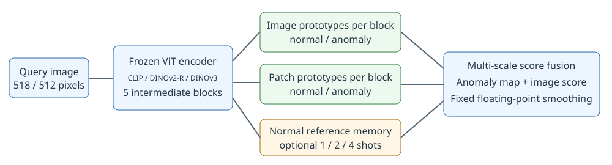
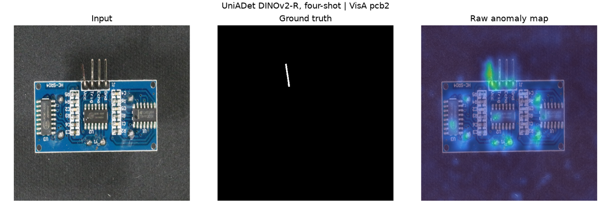

# UniADet

UniADet is a language-free zero- and few-shot anomaly detector based on
[One Language-Free Foundation Model Is Enough for Universal Vision Anomaly Detection](https://arxiv.org/abs/2601.05552)
by Bin-Bin Gao and Chengjie Wang.

## Architecture



Separate classification and segmentation heads compare features from five frozen transformer blocks with learned
normal/anomaly prototypes. In few-shot mode, the detector also compares patches with normal target images.

| `backbone` | Encoder              | Input size |
| ---------- | -------------------- | ---------- |
| `clip`     | OpenAI CLIP ViT-L/14 | 518 × 518  |
| `dinov2`   | DINOv2-R ViT-L/14    | 518 × 518  |
| `dinov3`   | DINOv3 ViT-L/16      | 512 × 512  |

The encoder weights download through timm (1.0.20 or newer), separately from the head.

## Usage

**No training is required with a pretrained head.** In an Anomalib checkout, sign in with approved access to the
[Hugging Face checkpoints](https://huggingface.co/csgaobb/UniADet) and import a head:

```bash
uv run --extra huggingface python -m tools.uniadet.author \
  --backbone dinov2 --source-dataset visa --output results/UniADet/author_weights
```

```python
from anomalib.data import MVTecAD
from anomalib.engine import Engine
from anomalib.models import UniADet

model = UniADet(
    backbone="dinov2", weights="results/UniADet/author_weights/dinov2_visa/head.pt", protocol="author", k_shot=0
)
Engine().test(model=model, datamodule=MVTecAD(root="datasets/MVTecAD", category="bottle"))
```

Set `k_shot=4` to use the same head with four normal references from the datamodule's training split or
`few_shot_source` (a directory of normal images). The author protocol samples with replacement using `seed`.
Use one reference bank per category. Neither mode updates weights.

`Engine.fit` calibrates label/mask thresholds without normalizing scores. Save a full checkpoint and pass it as
`ckpt_path` to `Engine.predict` to predict without a datamodule. Full checkpoints retain the reference bank and
reject changed reference settings. Load the head instead to change shots, seed, or reference source.

To train your own head, use a _different_, labeled auxiliary dataset:

```bash
uv run python -m tools.uniadet.train \
  --dataset visa --root datasets/visa/visa_pytorch --backbone dinov2 \
  --output results/UniADet/training/dinov2_visa
```

Independently trained heads use `protocol="legacy"`; they are not interchangeable with author heads.
`few_shot_weight` and `image_score_weight` customize legacy scoring only.

## Benchmarks

The author-checkpoint evaluation uses original MVTec AD and VisA splits, shots 0/1/2/4, and reference seeds
10/20/30 (zero-shot once). **All 96 image/pixel AUROC and paper AP means are within 0.07 percentage points**
of the paper. This reproduces evaluation with the authors' pretrained heads, not auxiliary training.

| Encoder  | MVTec AD image AUROC % (0 / 4 shots) | VisA image AUROC % (0 / 4 shots) |
| -------- | ------------------------------------ | -------------------------------- |
| CLIP     | 92.40 / 97.75                        | 87.96 / 93.26                    |
| DINOv2-R | 93.50 / 98.73                        | 91.27 / 96.92                    |
| DINOv3   | 93.98 / 98.20                        | 91.94 / 97.03                    |

The [full comparison][paper-comparison] uses the released loader's mixed FP16 CLIP and FP32 DINO precision.
The [benchmark archive][benchmark-archive] also includes uniform FP32 results and the evaluation protocol.
Paper AP is trapezoidal area under the precision-recall curve, not Anomalib's standard average precision.

```bash
uv run python -m tools.uniadet.reproduce \
  --weights results/UniADet/author_weights/dinov2_visa/head.pt \
  --dataset mvtec --root datasets/MVTecAD \
  --output results/UniADet/reproduction/dinov2_mvtec
```

For VisA, use the MVTec-trained head and the original `datasets/visa` directory, not `visa_pytorch`.
Use the reproduction tool rather than generic Engine evaluation to replay the released protocol.
Generated output stays in the ignored `results/` directory.

Independent training took 32–46 minutes per head on an RTX 3090 and did not match the paper overall.
Legacy FP32 GPU inference took 62–85 ms/image. On a four-thread i9-10920X, weight-only INT8 OpenVINO took
0.97–1.38 s/image. Timings exclude image decoding; see the [benchmark archive][benchmark-archive] for details.

## Deployment

Use `Engine.export` or the model's `to_torch`, `to_onnx`, and `to_openvino` methods at the encoder's fixed resolution.
Batch size is dynamic. Initialize the few-shot reference bank before export.
ONNX/OpenVINO inputs must already have the fixed spatial size; `OpenVINOInferencer` does not resize image files.

```bash
uv run --extra openvino --with onnxruntime python -m tools.uniadet.validate \
  --weights results/UniADet/author_weights/dinov2_visa/head.pt \
  --target mvtec --target-root datasets/MVTecAD --category bottle \
  --auxiliary-root datasets/visa/visa_pytorch --shots 4 \
  --output results/UniADet/deployment/dinov2_bottle_4
```

The [author deployment checks][deployment-checks] compare raw scores and maps at batches 1 and 3.
TorchInferencer, Engine, ONNX, and OpenVINO FP32/FP16 passed for all three encoders at zero and four shots.
FP16 refers to compressed weights, not FP16 CPU execution. The [review refresh][review-refresh] also checks
`OpenVINOInferencer`.
Use `TRUST_REMOTE_CODE=1` only for full-model Torch exports you created or otherwise trust.

Use FP32 or FP16 when scores and maps must agree with Torch. Weight-only INT8, INT8_PTQ, and INT8_ACQ
can exceed the `0.05` maximum map error limit. PTQ/ACQ use 32 calibration and 32 disjoint VisA
validation images, with bounded rollback for CLIP zero-shot ACQ. ACQ targets image AUROC, not map agreement.
DINOv2-R zero-shot PTQ still had `0.168` maximum map error with 300 calibration images.
The [quantization reports][quantization-reports] include the calibration, scoring, and runtime probes.

NNCF's output-based ACQ ranking can become undefined on all-zero outputs, including normal labels and masks.
This is also present in [NNCF 3.4.0](https://github.com/openvinotoolkit/nncf/blob/v3.4.0/src/nncf/quantization/algorithms/accuracy_control/rank_functions.py).
Aggregate AUROC remains measurable, but rollback ordering is not reliable for those samples.

## Licenses

The [authors confirm](https://github.com/gaobb/UniADet/issues/7#issuecomment-7075731743)
[Apache-2.0](https://github.com/gaobb/UniADet/blob/45272f0e65ba4e27f4921cd4c9819c40dd8e5aa4/LICENSE)
for original UniADet code and head weights. Anomalib implements the algorithm independently and does not bundle
checkpoints. Honor Hugging Face access and citation terms. Backbone weights use separate licenses: CLIP (MIT),
DINOv2 (Apache-2.0), and DINOv3 (Meta's DINOv3 License).

## Sample results

VisA examples from the independently trained DINOv2-R head at four shots. Panels show input, ground truth,
and anomaly overlay. See [sample provenance][sample-provenance].





Photos and masks: VisA, Zou et al. (2022), [CC BY 4.0](https://creativecommons.org/licenses/by/4.0/).
See the [asset notice](/docs/source/images/uniadet/results/LICENSE).

[benchmark-archive]: https://github.com/rajeshgangireddy/anomalib/tree/7c0285d89a993f01695b3eb2373ebab500d5df38/results/UniADet
[paper-comparison]: https://github.com/rajeshgangireddy/anomalib/blob/7c0285d89a993f01695b3eb2373ebab500d5df38/results/UniADet/reproduction/paper_precision_comparison.csv
[deployment-checks]: https://github.com/rajeshgangireddy/anomalib/blob/7c0285d89a993f01695b3eb2373ebab500d5df38/results/UniADet/reproduction/quantization/deployment_summary.csv
[review-refresh]: https://github.com/rajeshgangireddy/anomalib/blob/7c0285d89a993f01695b3eb2373ebab500d5df38/results/UniADet/reproduction/review/verification.json
[quantization-reports]: https://github.com/rajeshgangireddy/anomalib/tree/7c0285d89a993f01695b3eb2373ebab500d5df38/results/UniADet/reproduction/quantization
[sample-provenance]: https://github.com/rajeshgangireddy/anomalib/blob/7c0285d89a993f01695b3eb2373ebab500d5df38/results/UniADet/sample_images.json
