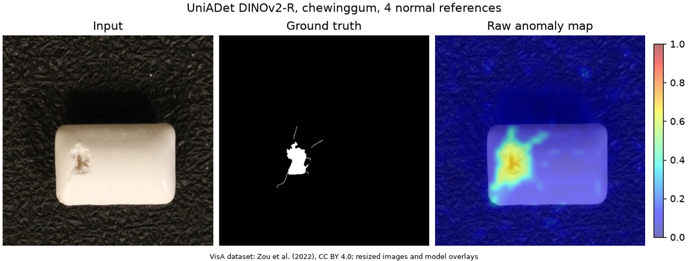
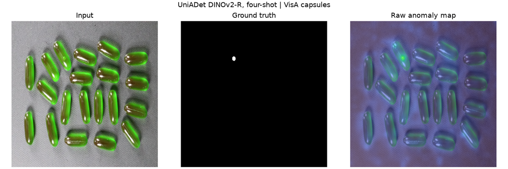

# UniADet

An independent implementation of **One Language-Free Foundation Model Is Enough for Universal Vision Anomaly Detection**
([paper](https://arxiv.org/abs/2601.05552), Bin-Bin Gao and Chengjie Wang).

UniADet learns separate normal/anomaly prototypes for classification and segmentation at five frozen transformer
blocks. The head is trained on **labeled anomalies from another dataset**, not on the target category. At deployment,
zero-shot inference uses those prototypes; few-shot inference also compares patches with normal target references.

## Architecture


The implementation uses `AnomalibModule`, `ImageBatch`, `InferenceBatch`, standard preprocessing/postprocessing callbacks,
and the existing export API. The target learning type is always zero-shot or few-shot. There is no Engine training-mode
workaround: auxiliary supervision runs through a standalone Lightning training tool.

| Encoder              | timm identifier                               | Input size | Head parameters |
| -------------------- | --------------------------------------------- | ---------- | --------------- |
| OpenAI CLIP ViT-L/14 | `vit_large_patch14_clip_quickgelu_336.openai` | 518        | 15,360          |
| DINOv2-R ViT-L/14    | `vit_large_patch14_reg4_dinov2.lvd142m`       | 518        | 20,480          |
| DINOv3 ViT-L/16      | `vit_large_patch16_dinov3.lvd1689m`           | 512        | 20,480          |

Use a timm version with these architectures; this integration is exercised with timm 1.0.29.
CLIP retains QuickGELU and its learned 768-dimensional projection. Register tokens are not spatial patches.

## Usage

First pretrain a head, using the full labeled **auxiliary test split**:

```bash
uv run python -m tools.uniadet.train \
  --dataset visa --root datasets/visa/visa_pytorch --backbone dinov2 \
  --output results/UniADet/training/dinov2_visa
```

The tool uses Adam (`lr=0.001`, `betas=(0.5, 0.999)`), 15 epochs, batch size 16, blocks 12/15/18/21/24,
and class-aware grid mosaic/cropping with probability 0.5. Only the head is optimized. The resulting `head.pt`
contains head tensors and configuration; `training.json` records the run. Encoder weights are not bundled in it.

```python
from anomalib.data import MVTecAD
from anomalib.engine import Engine
from anomalib.models import UniADet

model = UniADet(
    backbone="dinov2",
    weights="results/UniADet/training/dinov2_visa/head.pt",
    k_shot=4,
)
data = MVTecAD(root="datasets/MVTecAD", category="bottle")
engine = Engine()
engine.test(model=model, datamodule=data)
```

Use `k_shot=0` for zero-shot inference. Few-shot setup samples only normal training images, with an explicit seed.
Alternatively, supply `few_shot_source` containing only normal images. Use a separate model/reference bank per category.
Reference features are checkpoint buffers, so deployment does not require the original reference directory.

`Engine.fit` performs target calibration, **not auxiliary head training**. For prediction without a datamodule,
save a full checkpoint after calibration and pass it as `ckpt_path` to `Engine.predict`; the existing Engine otherwise
runs validation before predicting with a zero-/few-shot model.

## Reproduction and benchmarks

Train on VisA to evaluate MVTec AD; train on MVTec AD to evaluate VisA. Evaluating a head on the dataset used for its
auxiliary supervision is test-label leakage. The helper rejects that combination.

```bash
uv run python -m tools.uniadet.benchmark \
  --weights results/UniADet/training/dinov2_visa/head.pt \
  --dataset mvtec --root datasets/MVTecAD \
  --output results/UniADet/benchmark/dinov2_mvtec
```

The default sweep covers 0/1/2/4 shots and reference seeds 10/20/30 (zero-shot is evaluated once), with image/pixel
AUROC and average precision. It reuses frozen encoder outputs across shot settings, uses 256-pixel evaluation masks,
and records category-level measurements and selected references. Compute macro category means, not pooled-dataset AUROC.

```bash
uv run python -m tools.uniadet.report \
  results/UniADet/benchmark/dinov2_mvtec results/UniADet/benchmark/dinov2_visa \
  --output results/UniADet/comparison.csv
```

The report helper rejects partial category/seed coverage, smoke-trained heads, obsolete training recipes,
duplicated rows, and nonfinite scores.
It averages categories within each seed before reporting seed mean/population standard deviation, and computes
signed percentage-point gaps to the explicitly attributed paper Tables 2/5/10/11.

**This independent implementation does not reproduce the paper's overall headline accuracy.** The paper specifies fusion
weights of 0.5, whereas the released demo documentation gives different weights and source-side score recalibration.
This implementation follows the paper equations. It uses torchvision/timm rather than the authors' vendored encoders
and Albumentations pipeline. The corrected recipe uses temperature 0.07, Gaussian prototype standard deviation 0.02,
training seed 10, focal exponent 2 with smoothing 1e-5, and linear-denominator two-class Dice with smoothing 1.
These factual parameters were checked against the authors' published declarations; no upstream code was copied.
Training also enables color jitter (brightness/contrast/saturation 0.4, hue 0.1, probability 0.5),
right-angle rotation (0.5), channel shuffle/grayscale (0.25 each), and horizontal/vertical flips (0.5 each).
Backbone implementations, augmentation sampling and score processing can still differ; matching headline numbers
is not asserted.

### FP32 reproduction diagnosis

The component audit now confirms concrete differences, rather than attributing the gap to unspecified variance.
Using the **same recipe-v2 heads, features and seed-10 normal references**, the published industrial executable's
score processing recovers most of the four-shot MVTec image-AUROC gap across all 15 categories:

| Encoder  | Existing scoring | Published executable scoring | Paper |
| -------- | ---------------- | ---------------------------- | ----- |
| CLIP     | 94.35            | 97.64                        | 97.7  |
| DINOv2-R | 94.89            | 98.62                        | 98.7  |
| DINOv3   | 94.34            | 98.24                        | 98.2  |

These are **single-reference-seed diagnostic image metrics**, not replacement three-seed benchmarks or new pixel
results. The original measurements below remain unchanged. The executable uses reference fusion weight 0.8,
zero-shot image-map weight 0.1, sigmoid map recalibration, additional reference smoothing, and different interpolation/
peak-extraction ordering. On DINOv2-R, changing the reference fusion weight alone raises four-shot image AUROC
from 94.89 to 97.53; the complete executable scoring combination reaches 98.62.
The comparator is pinned to upstream commit `2b81369d418ed08fd882452597ad5ebe7df3cb1d`.
This does not prove which undocumented executable settings generated the paper tables.

The inverse checks cover all 12 VisA categories too. Four-shot image AUROC changes 91.71/94.55/93.95
to 92.80/96.62/95.41 for CLIP/DINOv2-R/DINOv3, versus paper 93.3/96.9/97.1.
Zero-shot DINOv3 improves 87.80 to 92.10, but CLIP worsens 88.04 to 87.10.
Thus this is not a universal fix: residual gaps remain, including 1.69 points for four-shot VisA DINOv3.
Both directions and all prespecified variants are in `results/UniADet/diagnosis/scoring_comparison.csv`.

Other verified differences remain:

- The local DINOv2-R/DINOv3 adapters apply final LayerNorm to intermediate features; the authors' detection
  forwards return those blocks without it. LayerNorm changes feature directions and is not canceled by cosine
  normalization. Existing heads were trained on the local features; simply changing inference normalization
  would invalidate that pairing.
- The author training executable uses VisA mask-centered/history-based cropping and MVTec-specific mosaics,
  rather than the local crop/mosaic mixture for both datasets. Equal transform probabilities did not establish
  equivalent training distributions.
- The author reference sampler uses `randint` with replacement, while the local sampler uses `randperm` without
  replacement. All 45 audited MVTec category/seed four-shot selections differ despite equal numeric seeds.
- Training probability-map interpolation also differs: local `align_corners=True` versus the executable's
  `False`. Matching the CE/focal/Dice formulas does not remove this difference.

A separate paired 15-epoch experiment uses 510 auxiliary images from three fixed VisA categories, identical
initial heads/batches/augmentations, and four fixed MVTec categories. Removing final LayerNorm changes baseline
zero-/four-shot image AUROC from 89.58/94.83 to 91.26/96.45. With executable scoring, the corresponding changes
are 94.54/98.68 to 94.22/98.73. Thus the feature mismatch has a measured effect, but is not a uniform improvement
or an established dominant cause of the four-shot headline gap. This bounded experiment is not full-dataset retraining.
A separate fixed-head reference-sampler probe on those four target categories changes executable-scoring
four-shot image AUROC from 98.52 to 98.07 when switching to the author's with-replacement RNG algorithm
on the local normal-image pool. Original author reference manifests remain unavailable.

Block indexing, CLS/register-token exclusion, CLIP projection, normal-only reference pools, macro-category
aggregation, and independently checked metric arithmetic pass their component checks. All six existing loss
curves are finite and improve; this alone does not establish training equivalence.
The public demo exposes a rendered overlay and rounded score, not a feature/logit oracle; no local data was uploaded.
Detailed evidence and targeted author questions are under `results/UniADet/diagnosis/`.
Production scoring and quantization settings have **not** been changed by these diagnostic experiments.

To reproduce the fixed-protocol scoring ablations without retraining:

```bash
uv run --no-sync python -m tools.uniadet.diagnose \
  --weights results/UniADet/training/dinov2_visa/head.pt \
  --dataset mvtec --root datasets/MVTecAD \
  --output results/UniADet/diagnosis/dinov2_scoring_full
```

The helper verifies its baseline against the integrated detector before marking results complete, and writes
per-category/per-image measurements and head provenance. It never selects a variant by optimizing target labels.

### Recipe-v2 benchmark measurements

All six full auxiliary runs and cross-dataset evaluations are complete under `results/UniADet/`.
All deployment conversions are complete, with activation-quantization limitations detailed below.
Every replacement head was trained from scratch with corrected **recipe version 2**.
Initial-recipe measurements are archived under `results/UniADet/initial_recipe/`, with explicit deviations in
[provenance.json](/results/UniADet/initial_recipe/provenance.json): prototype standard deviation 1 instead of 0.02,
seed 1015 instead of 10, a different Dice/interpolation convention, and missing color/geometric transforms.
Cosine normalization does not cancel the initialization scale's effect on Adam's angular updates.
Those initial measurements must not be used as corrected-recipe or paper-reproduction results.
Both corrected directions for all three encoders are complete, covering all 15 MVTec AD and 12 VisA categories
and every default shot/seed setting.
Selected macro category means are percentages:

| Encoder  | Target   | Shots | Image AUROC | Pixel AUROC | Image AP | Pixel AP |
| -------- | -------- | ----- | ----------- | ----------- | -------- | -------- |
| CLIP     | MVTec AD | 0     | 90.26       | 91.33       | 95.19    | 40.88    |
| CLIP     | MVTec AD | 4     | 94.25       | 95.44       | 97.21    | 51.50    |
| CLIP     | VisA     | 0     | 88.04       | 95.59       | 90.02    | 27.39    |
| CLIP     | VisA     | 4     | 91.70       | 97.18       | 93.51    | 31.99    |
| DINOv2-R | MVTec AD | 0     | 91.31       | 91.79       | 95.67    | 46.83    |
| DINOv2-R | MVTec AD | 4     | 94.73       | 97.09       | 97.70    | 55.93    |
| DINOv2-R | VisA     | 0     | 89.08       | 95.86       | 91.36    | 31.87    |
| DINOv2-R | VisA     | 4     | 94.41       | 97.81       | 95.94    | 37.12    |
| DINOv3   | MVTec AD | 0     | 91.75       | 91.62       | 95.79    | 49.85    |
| DINOv3   | MVTec AD | 4     | 94.28       | 97.30       | 97.54    | 59.47    |
| DINOv3   | VisA     | 0     | 87.80       | 96.34       | 90.12    | 32.65    |
| DINOv3   | VisA     | 4     | 93.45       | 97.79       | 94.75    | 37.32    |

Some zero-shot VisA metrics match or exceed the paper: CLIP image AUROC is 88.04 versus 88.0.
Other gaps remain substantial: four-shot MVTec image AUROC is 94.25/94.73 for CLIP/DINOv2-R,
versus the paper's 97.7/98.7. Reproducing its overall headline accuracy is not claimed.
All 96 metric/shot/dataset/encoder comparisons, reference-seed variability and attributed paper gaps are in
[comparison.csv](/results/UniADet/comparison.csv). No partial category or seed coverage is presented as complete.
Real-IAD data support and benchmarks are reserved for a separate follow-up PR.

### Training resources

Each complete 15-epoch FP32 run uses one RTX 3090 and batch size 16. One auxiliary head covers all target categories;
these are whole-run times, not per-category training. Runs share a development host, so this is not a hardware-matched
comparison with the authors' training timings. Peak memory means PyTorch allocated memory, not total device usage.

| Encoder  | VisA training (min) | MVTec training (min) | Peak allocated GPU (GiB) |
| -------- | ------------------- | -------------------- | ------------------------ |
| CLIP     | 42.29               | 45.42                | 2.890                    |
| DINOv2-R | 40.95               | 46.34                | 2.810                    |
| DINOv3   | 31.86               | 31.76                | 2.575                    |

Exact durations, step counts, sample counts, head hashes and hardware are in
[training_summary.csv](/results/UniADet/training_summary.csv) and the six source training manifests.

### GPU inference

FP32 inference on one RTX 3090, without autocast, compilation or TF32, uses five warmups and 30 synchronized
CUDA-event repetitions. Inputs are already resized to the encoder resolution. Timings include model preprocessing,
the encoder, scoring and map postprocessing, but exclude image decoding, initial CPU resizing and checkpoint loading.
Task-owned GPU training and category evaluation had finished; the development host remains shared.

| Encoder  | Shots | Batch 1 (ms) | Batch 3 total (ms) | Batch 3 images/s |
| -------- | ----- | ------------ | ------------------ | ---------------- |
| CLIP     | 0     | 81.97        | 218.16             | 13.75            |
| CLIP     | 4     | 85.33        | 227.96             | 13.16            |
| DINOv2-R | 0     | 78.04        | 209.10             | 14.35            |
| DINOv2-R | 4     | 82.83        | 223.25             | 13.44            |
| DINOv3   | 0     | 61.84        | 162.14             | 18.50            |
| DINOv3   | 4     | 64.67        | 169.18             | 17.73            |

Values are median batch latencies. Full protocol, head hashes and memory measurements are in
[gpu_inference.json](/results/UniADet/gpu_inference.json). These are not end-to-end file-serving latencies.

### CPU inference

Controlled timings use an Intel Core i9-10920X, four threads pinned to four physical cores, two warmups and five
repetitions. Task-owned conversion/training jobs had finished; the development host remains shared.
OpenVINO requests FP32 floating-point execution, including for compressed FP16 weights.
Median batch-1 latency is in **seconds**:

| Encoder  | Shots | Torch FP32 | OV FP32 | OV FP16 | OV INT8 | OV PTQ | OV ACQ |
| -------- | ----- | ---------- | ------- | ------- | ------- | ------ | ------ |
| CLIP     | 0     | 2.307      | 1.908   | 1.666   | 1.303   | 0.775  | 0.781  |
| CLIP     | 4     | 2.057      | 1.980   | 1.746   | 1.361   | 0.804  | 0.805  |
| DINOv2-R | 0     | 1.904      | 1.890   | 1.653   | 1.288   | 0.767  | 0.767  |
| DINOv2-R | 4     | 2.012      | 2.032   | 1.759   | 1.377   | 0.809  | 0.808  |
| DINOv3   | 0     | 1.405      | 1.376   | 1.233   | 0.968   | 0.579  | 0.578  |
| DINOv3   | 4     | 1.451      | 1.491   | 1.283   | 0.986   | 0.599  | 0.599  |

OV INT8 is weight-only compression. PTQ/ACQ timings are measured, **not numerically certified**: their maximum map
errors fail the declared tolerance. This is not a real-time CPU detector on this hardware.
All 72 backend/batch/case timing entries, including batch-3 latency/throughput and repeated numerical checks, are in
[cpu_inference.json](/results/UniADet/cpu_inference.json). Decoding, initial resizing, loading and compilation are excluded.

## Deployment

Standard `to_torch`, `to_onnx`, `to_openvino`, and `Engine.export` entrypoints are used. Export at the model's fixed
spatial resolution with dynamic batch size; initialize the normal reference bank first for few-shot deployment.
ONNX export uses the dynamo exporter and opset 18. Full Torch exports contain encoder weights and are for local use,
subject to those weights' licenses.

```bash
uv run python -m tools.uniadet.validate \
  --weights results/UniADet/training/dinov2_visa/head.pt \
  --target mvtec --target-root datasets/MVTecAD --category bottle \
  --auxiliary-root datasets/visa/visa_pytorch --shots 4 \
  --output results/UniADet/deployment/dinov2_bottle_4
```

This checks TorchInferencer, Engine, ONNX Runtime, and OpenVINO FP32/FP16/INT8/INT8_PTQ/INT8_ACQ for batches 1 and 3.
It additionally checks a raw-resolution image path through TorchInferencer and both Engine predict/test APIs.
Corrected CLIP, DINOv2-R and DINOv3 zero-/four-shot file/tensor Torch, Engine predict/test, ONNX, FP32, FP16 and
weight-only INT8 checks pass. Activation PTQ/ACQ conversions run successfully but fail strict map tolerances below.
Separate real CUDA checks also pass file/tensor TorchInferencer and checkpoint-restored Engine predict/test for
all six encoder/shot cases and batches 1/3. Same-device API tolerance is `1e-5`; CPU/CUDA FP32 tolerance is `1e-4`.
The largest observed CPU/CUDA map difference is `3.61e-5`. See
[gpu_inference_api.json](/results/UniADet/gpu_inference_api.json).
`parity.json` records maximum/mean absolute error and RMSE for scores and maps. Tolerances are fixed before comparison:
`1e-5` for Torch/Engine, `1e-4` for ONNX/FP32, `0.005` for FP16, and `0.05` for INT8 variants.
Quantization is approximate, not bit-identical; conversion success alone does not establish accuracy.
The per-export reports retain CPU timings with four threads, one warmup and three measured repetitions per batch size.
These shared-host timings include in-model preprocessing/postprocessing, but exclude image decoding and compilation.
These conversion-time measurements had concurrent calibration load and are not a fair speed ranking.
Use the separately controlled CPU measurements above.
The CPU checks request FP32 floating-point execution: FP16 denotes compressed stored weights, not a native FP16
CPU-kernel benchmark. INT8 denotes weight-only compression; PTQ/ACQ also quantize activations.

PTQ and ACQ use disjoint auxiliary-domain calibration and validation subsets (300 images each by default).
ACQ uses aggregate image AUROC with maximum drop 0.01; metric state is reset between candidates.
Continuous task outputs drive sensitivity ranking, because single-image AUROC is undefined.
Both paths use NNCF's
transformer-aware recipe, including SmoothQuant, rather than generic convolutional-network quantization.
Fixed map resizing and Gaussian smoothing remain floating point: calibrating these operations on the auxiliary domain
can clip unseen-domain anomaly maps. This is not a fully integer
graph. Final target-dataset accuracy still needs separate measurement.
All six corrected zero-/four-shot PTQ/ACQ cases have completed. Both formats produce the same measured errors because
native ACQ already meets its auxiliary image-AUROC constraint without reverting quantizers:

| Encoder  | Shots | Initial auxiliary AUROC | Quantized AUROC | Absolute drop | Maximum map error |
| -------- | ----- | ----------------------- | --------------- | ------------- | ----------------- |
| CLIP     | 0     | 0.935060                | 0.930424        | 0.004635      | 0.10547           |
| CLIP     | 4     | 0.943751                | 0.935951        | 0.007800      | 0.06266           |
| DINOv2-R | 0     | 0.928374                | 0.921020        | 0.007354      | 0.06151           |
| DINOv2-R | 4     | 0.936219                | 0.927839        | 0.008379      | 0.08991           |
| DINOv3   | 0     | 0.934480                | 0.933901        | 0.000579      | 0.09730           |
| DINOv3   | 4     | 0.935728                | 0.934792        | 0.000936      | 0.06512           |

AUROC values use 300 disjoint auxiliary-domain validation images. Map errors use the MVTec bottle numerical
inputs at batches 1/3, not an all-category quantized benchmark. All six maximum map errors exceed the unchanged
0.05 tolerance, despite small mean errors and passing score checks.
Preserving AUROC does not guarantee per-pixel amplitude agreement.
See [activation_accuracy_control.json](/results/UniADet/activation_accuracy_control.json) and each parity report.
Cached-IR replay of DINOv2-R zero-shot rules out a batch-size effect.
A narrow binary-head-only exclusion did not fix the drift and was not adopted.
See [the numerical diagnosis](/results/UniADet/deployment/dinov2_mvtec_0_activation/ptq_diagnosis.json).
For DINOv2-R four-shot, bypassing only reference-query quantizers does not improve the map maximum.
Bypassing only RGB patch-input quantization reduces 0.08991 to 0.06544 but still fails, and worsens score error;
neither change is adopted. See [the four-shot diagnosis](/results/UniADet/deployment/dinov2_mvtec_4_activation/ptq_diagnosis.json).
No broad precision exclusions or relaxed tolerances are used.
The [complete deployment summary](/results/UniADet/deployment_summary.csv) contains 114 batch/format measurements:
18 fail the map criterion, all in activation PTQ/ACQ; all score checks pass.
Use FP32, compressed FP16 or weight-only INT8 for the checked numerical consistency.
Activation variants are not certified equivalent under the declared maximum-map tolerance.

The legacy TorchInferencer requires `TRUST_REMOTE_CODE=1` for locally generated full-model exports. Never enable this
for an untrusted downloaded pickle. The helper scopes this flag to loading its own newly generated export.

## Provenance and licenses

No source from `gaobb/UniADet` is copied or vendored. Its repository currently has no published source-code license;
an MIT grant must not be assumed. The independent implementation is covered by anomalib's Apache-2.0 license.
The paper and upstream repository are acknowledged as the algorithm's origin, not as licensed source dependencies.

The encoder implementations come from Apache-2.0 timm (minimum 1.0.20 for DINOv3 and the required feature API).
Pretrained weights have separate terms, especially DINOv3's
custom Meta license; see each publisher's model card before use or redistribution. The authors' gated
`csgaobb/UniADet` head checkpoints could not be accessed with the current credentials (HTTP 403) and are not bundled.
Source/head-weight licensing clarification remains a gate before an upstream PR.

MVTec AD is CC BY-NC-SA 4.0; VisA's dataset license is CC BY 4.0. Training on public datasets does not remove their
use restrictions. No raw dataset files or checkpoints are committed. Documentation panels are separately attributed
derived VisA assets.

## Sample results

These VisA examples use the completed recipe-v2 MVTec-trained DINOv2-R head and four normal references (seed 10).
Panels show input, ground truth, and a raw anomaly-map overlay on a fixed 0-to-1 scale.
All six candidates were visually inspected; three with distracting normal-region activations were excluded.
The retained examples are qualitative, not evidence that the paper's accuracy is reproduced.
Run and selection provenance is in [sample_images.json](/results/UniADet/sample_images.json).





Photographs/masks: VisA, Zou et al. (2022), [CC BY 4.0](https://creativecommons.org/licenses/by/4.0/);
resized and overlaid with model outputs. See the [asset notice](/docs/source/images/uniadet/results/LICENSE).
